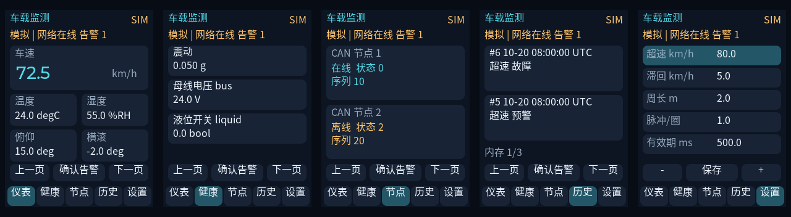

# RK3588 车载智能监测与设备健康管理系统

以《基于RK3588B的车载智能监测与设备健康管理系统技术任务书.txt》为需求基线，面向正点原子 ATK-DLRK3588B 的 Linux/C++17 工程。

当前交付：完成软件阶段1（工程基础）、阶段2（采集算法和多故障诊断）、阶段3（循环日志和导出）、阶段4（CAN节点管理和TCP通信）与阶段5（LVGL界面），程序版本v0.1.0。详见[阶段计划](docs/roadmap.md)与[阶段2验证](docs/reports/stage2-validation.md)。实板驱动、实际屏幕/触摸、CAN物理链路与板端TCP验证、W25Q128实板持久化及完整系统验收尚未完成。仿真不能替代硬件验收。

## 本机运行

```sh
./scripts/check.sh
./build/vehicle-monitor --simulate --duration 5 --config config/vehicle.conf
./build/vehicle-monitor --version
```

Ctrl+C/SIGTERM 可优雅退出。演示产生交替60/90 km/h的明确模拟数据，新增合成姿态、母线与液位异常场景；温湿度保持无效。不指定日志文件时只输出stdout；使用 `--log-file` 可启用文件模拟NOR循环日志，不代表已写入Flash。关键与普通队列分别有界，关键溢出或写失败使程序非零退出。详见[日志运行与导出](docs/storage.md)。

## 图形界面

```sh
# 有SDL2和桌面的主机
./build/vehicle-monitor --simulate --can-simulate --duration 60 --gui
# 无桌面或ARM64构建可用离屏渲染
./build/vehicle-monitor --simulate --duration 5 --gui-headless --gui-capture /tmp/vehicle-ui.ppm
```



截图使用合成数据。页面交互、中文字体、历史窗口、配置保存及后端限制见[GUI说明](gui/README.md)。

## 通信演示

```sh
# 终端1
python3 tools/monitor_server.py --port 9000 --duration 60
# 终端2
./build/vehicle-monitor --simulate --can-simulate --duration 30 --tcp 127.0.0.1:9000
```

远程参数默认只读；显式开启写入和SocketCAN测试方法见[通信说明](docs/communication.md)。CAN节点与TCP在线状态进入诊断；不缓存离线网络告警。

## 交叉编译

使用厂商SDK配套的 AArch64 Linux 工具链，不能使用旧工程的 arm-none-eabi-gcc。

```sh
export RK_CROSS_PREFIX=/实际SDK路径/bin/aarch64-linux-gnu-
# SDK要求显式sysroot时设置 RK_SYSROOT；勿填写其他SDK的sysroot
cmake -S . -B build-rk -DCMAKE_TOOLCHAIN_FILE=cmake/aarch64-linux.cmake -DBUILD_TESTING=OFF
cmake --build build-rk -j2
```

已找到本机厂商SDK并完成交叉编译，可执行 `./scripts/build_rk.sh`。板端SSH当前返回No route to host，板端执行待验证。详见 [SDK验证记录](docs/reports/sdk-validation.md)。部署说明见 [deploy](deploy/README.md)。

## 工程入口

- `include/vehicle/`、`src/`：快照、队列、配置、诊断、协议及模拟运行管理。
- `platform/linux/`：设备访问合同；`gui/`：LVGL页面、SDL/离屏后端及GUI运行服务。
- `config/`、`cmake/`、`deploy/`：配置、工具链及部署边界。
- `protocols/`、`tests/`：已实现的台架协议及主机测试；见[通信联调](docs/communication.md)。
- `scripts/board_probe.sh`：板端只读环境探测。
- [可行性报告](docs/feasibility.md)、[架构与待办](docs/architecture.md)、[接口冻结表](docs/hardware/interfaces.csv)、[验收矩阵](docs/acceptance.csv)。

`moni_traffic/`为保留的STM32历史参考，根构建不使用它。旧文档中的供电、引脚、怠速与可靠性描述不得作为本项目已验证结论。旧树LVGL实际为8.3.11，与任务书8.2不一致。

## Git 迁移

远程仓库：https://github.com/Arucarer/rk3588_vehicle_monitor

```sh
git clone https://github.com/Arucarer/rk3588_vehicle_monitor.git
cd rk3588_vehicle_monitor
./scripts/check.sh
```

`.gitignore`排除构建产物、IDE本地配置、重复RAR和约249MB的STM32参考目录`moni_traffic/`。原始任务书与背景文档纳入版本管理；本地历史参考资料保持原位，新Linux工程构建不依赖它们。
