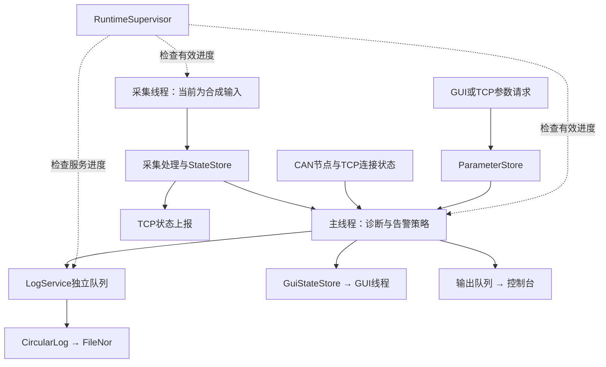

# 系统架构

## 分层与职责

| 层次 | 模块 | 职责 |
|---|---|---|
| 平台适配 | Linux驱动接口、SocketCAN、NOR抽象 | 设备访问与错误状态，见[平台说明](../platform/README.md) |
| 数据处理 | acquisition、core | 原始信号处理、统一单位、快照与有效期 |
| 业务服务 | diagnosis、commands、can_node、network | 多故障、参数、节点与TCP通信 |
| 存储与界面 | storage、gui | 异步持久化、历史查询与五页面展示 |
| 运行管理 | main、runtime、deploy | 服务组装、进度监督、退出与恢复 |

当前实现按上述职责组织，但部分服务组装仍在main.cpp；平台层多数是待适配合同，并非已实现全部硬件后端。

## 数据流

告警策略当前计算LED/蜂鸣器逻辑输出，实际GPIO尚未接入。GUI历史可读取日志服务提供的已提交记录窗口；文件NOR不代表外接Flash。

## 线程与通信

采集约20ms发布快照，诊断主循环约50ms检查，GUI数据目标10Hz更新。CAN、TCP、存储、GUI与设置服务独立处理工作；LVGL由GUI线程调用。周期为软件目标，不能推断硬实时保证。

`StateStore`短锁复制完整快照；网络和诊断分别读取，不共享抢读队列。控制台、日志及GUI请求各自通信；日志关键事件与普通样本分别有界，显式统计溢出，关键记录失败触发错误处理。磁盘I/O不长期持有采集共享锁。

## 时间与失效

`Measurement`携带值、单位、来源、有效位、单调采样时间和错误码。诊断先检查有效性与新鲜度，再执行持续时间、滞回及恢复规则；确认不清除仍存在的故障。历史记录附带日历时间、时钟同步标记、软件与配置标识。

监督依据有用工作进度区分空闲与卡死，异常促使进程退出，再由部署监督策略处理。健康门控计数不是实际喂狗；当前应用不打开硬件看门狗。

## 从架构读到源码

先看[接口类型](../include/vehicle/README.md)，再看[main运行主线](../src/README.md)，随后读[日志格式](storage.md)、[通信](communication.md)和[界面](../gui/README.md)。已有结果见[报告索引](reports/README.md)，真实设备工作见[实板清单](hardware/next-steps.md)。
